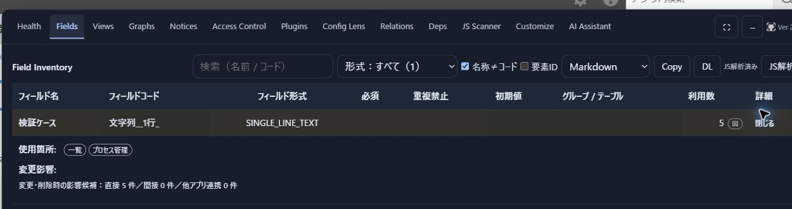
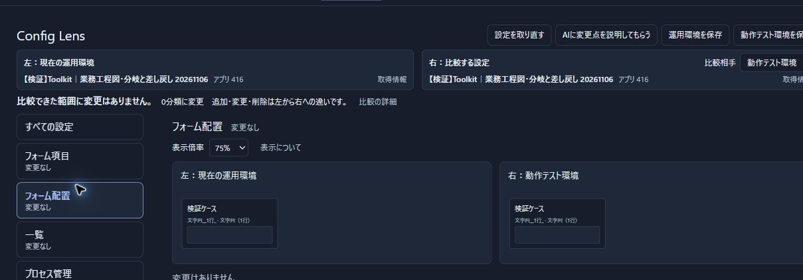
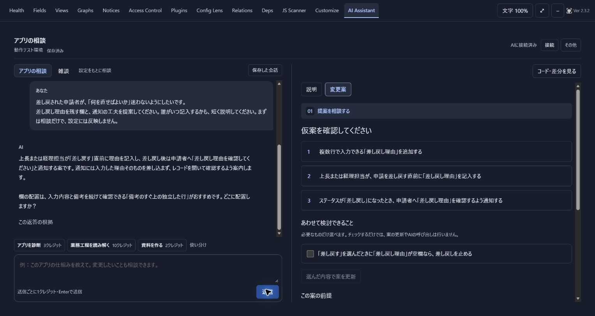

# kintone App Toolkit

> **開発中：2.3.4 公開候補（未公開）**。現在の公開版は2.3.3です。[候補の変更点](docs/RELEASE-NOTES-2.3.4.md)・[検証状況](docs/RELEASE-CANDIDATE-2.3.4.md)。下記の導入リンクは公開中の2.3.3を取得します。

**kintoneの設定を無料で調べる・比べる。必要なときは、AIと改善を考える。**

アプリを開いたまま、項目の使用箇所・アプリ間のつながり・変更前後の設定を確認できます。AIを接続すると、診断や資料作成、フィールド・条件・JavaScriptの変更案も相談できます。

[導入する](#導入は3ステップ) · [機能の早見表](#機能の早見表) · [実機で見る使い方](#実機で見る使い方) · [料金・接続案内](https://www.nestrec.com/toolkit)

**公開版：2.3.3**（2026年11月11日）。[今回の修正内容](docs/RELEASE-NOTES-2.3.3.md)

*無料の設定確認の例。検証用の項目が一覧とプロセス管理で使われていることと、直接の影響候補5件を表示しています。2.3.0で撮影。画像をクリックすると拡大できます。*

## 機能の早見表

無料の基本機能には、AI契約もAPIキーも不要です。

| やりたいこと | 確認・操作できること | 利用条件 |
|---|---|---|
| アプリの構成を把握する | フィールド、一覧・グラフ、通知、アクセス権、プロセスをまとめて確認 | 無料 |
| 変更前に使用箇所を調べる | 項目・JavaScript・他アプリの依存関係と、変更影響の候補を確認 | 無料 |
| 変更前後を比べる | Config Lensで運用環境と動作テスト環境の設定・フォーム配置を比較。保存した設定とも比較 | 無料 |
| 設定資料を残す | 取得した設定や解析結果をMarkdown・CSV・JSONなどで保存 | 無料 |
| 登録済みコードを見直す | JavaScript／CSSの確認・手編集、プラグイン構成の確認と管理 | 無料・必要な管理権限 |
| 見直す場所を相談する | AIによるアプリ診断、業務工程の整理、改善相談 | AI接続・クレジット |
| 相手に合わせて説明する | AIと相談しながら概要・仕様・操作説明・引継ぎ資料を作成 | AI接続・クレジット |
| 改善案を具体化する | AIとフィールド・条件・JavaScriptの案を作り、内容を確認して動作テスト環境へ反映 | AI接続・クレジット・必要な管理権限 |

クレジットはAIへの相談・生成などで使用し、反映操作そのものでは消費しません。

AIの月額プランは税込2,480円から。会員登録後、Toolkitの契約画面または接続を初めて利用すると、初回10クレジットを一度だけ受け取れます。特典の利用に支払い情報は不要で、自動で有料契約へ移行しません。[料金・利用条件はこちら](https://www.nestrec.com/toolkit)。

## 実機で見る使い方

自社の検証用アプリで撮影した画像です。撮影版・表示例は各画像に記載しています。

### 1. 項目を変える前に、使用箇所を調べる

冒頭のFields画面では、項目を選ぶと使用箇所と変更影響の候補を開けます。名前・コード・形式で探し、一覧・プロセス・計算式・JavaScriptなど、変更前に確認する場所を整理できます。

### 2. アプリを更新する前に、変更内容を比べる

*2.3.0で撮影した「変更なし」の例です。差分を検出した画面ではありません。画像内の75%はフォーム配置プレビューの表示倍率です。*

Config Lensは、設定の種類や追加・変更・削除で絞り込み、変更前後を見比べられます。比較・保存だけで設定が反映されたり、AIへ送信されたりすることはありません。

### 3. 今の設定を踏まえて、AIと改善案を考える

*2.3.2で撮影。経費申請の検証アプリで「差し戻された人が直す内容を迷わないようにしたい」と相談した例です。相談と仮案の表示までで、最終案の作成・設定反映は行っていません。*

左の会話と右の案を見比べながら、希望や残したい動きを伝えます。内容が決まったら作成・確認へ進み、利用者の操作で動作テスト環境へ反映します。**相談しただけでは設定は変わりません。AI機能から運用環境へ直接反映しません。**

## 導入は3ステップ

PC版のChrome・Edge・Firefoxと、利用できるkintone環境が必要です。kintoneにプラグインZIPを読み込む方式ではありません。

1. **[Tampermonkey](https://www.tampermonkey.net/)をブラウザーに追加する。**
2. **[公開中のToolkitを開く](https://raw.githubusercontent.com/youtotto/kintone-app-toolkit/main/kintoneAppToolkit.user.js)。** Tampermonkeyの画面でインストールする。
3. **kintoneアプリを開き、Toolkitを使う。** まずは無料の設定確認から。AIを使う場合だけ、[料金・接続案内](https://www.nestrec.com/toolkit)に沿ってNest Rec会員で接続する。

既存版から更新するときは、必要な会話・コードを保存してから上記スクリプトを開き、更新後にkintoneアプリを再読み込みしてください。[2.3.3の変更点と更新方法](docs/RELEASE-NOTES-2.3.3.md)

## 使う前に知っておきたいこと

- **取得できる範囲はkintoneの権限によります。** 他アプリからの参照は、必要なときに走査します。
- **解析結果には推定が含まれます。** 動的なJavaScriptや取得できないコードなどは確認できない場合があります。「未検出」は「変更・削除して安全」という意味ではありません。
- **設定資料は完全なバックアップではありません。** Config Lensの保存ファイルにはレコード・添付ファイル・JavaScript／CSS本文・手元の未登録編集は含みません。
- **反映は内容を確認してから行います。** 運用環境への更新は、そのアプリの他の未反映変更も対象になります。AIの生成物は動作テスト環境で実際の動きを確認してください。
- **AIには相談に必要な情報を送ります。** アプリ設定、取得したJavaScript本文、入力した相談文などが対象です。[データの取扱い](https://www.nestrec.com/toolkit)をご確認ください。

## 詳しく調べる

| 資料 | 内容 |
|---|---|
| [機能リファレンス](docs/feature-reference.md) | 各タブの使い方、解析範囲、安全性、API一覧、過去の更新履歴 |
| [AI Assistantのガイド](docs/release-workspace.md) | 相談・資料作成・変更案・反映・会話保存の流れと確認範囲 |
| [2.3.3の修正内容](docs/RELEASE-NOTES-2.3.3.md) | 自動検証できない条件でのJS生成と、工程カードの配色の修正 |
| [2.3.0の主な変更](docs/RELEASE-NOTES-2.3.0.md) | 設定比較、AIによる診断・相談・開発支援 |
| [製品ページ](https://www.nestrec.com/toolkit) | 料金、導入・接続、契約管理、お問い合わせ |

最近の更新履歴

| 版 | 公開日 | 主な変更 |
|---|---|---|
| [2.3.3](docs/RELEASE-NOTES-2.3.3.md) | 2026-11-11 | 自動検証できない条件でも作成済みコード・説明・未確認の理由を保持。工程カードの配色を修正 |
| [2.3.2](docs/RELEASE-NOTES-2.3.2.md) | 2026-11-11 | 通常の会員接続で、通信断後の保存済み回答を再生成・追加消費なしで回収 |
| [2.3.1](docs/RELEASE-NOTES-2.3.1.md) | 2026-11-11 | 一般配布から検証専用機能を除き、会員の承認による接続に統一 |
| [2.3.0](docs/RELEASE-NOTES-2.3.0.md) | 2026-11-10 | Config Lensの比較・フォーム配置と、AIによる診断・資料作成・開発支援 |

[以前の更新履歴](docs/feature-reference.md#-更新履歴)

## ライセンス

[MIT License](LICENSE.md) · Copyright (c) 2025 [youtotto](https://github.com/youtotto)
